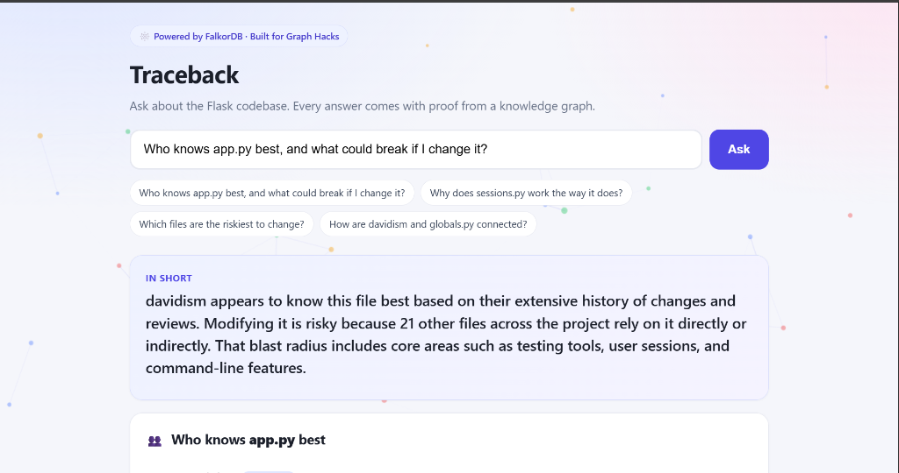
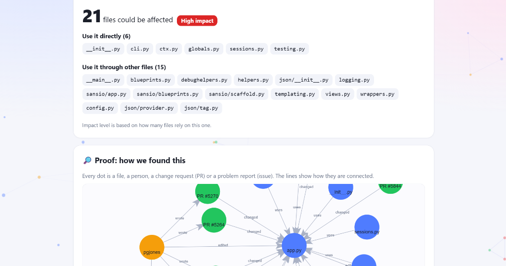

# Traceback

**Understand the code. Trace the decisions. Find the people who know.**

Traceback is an AI agent that answers three questions about a real codebase, and shows its proof for each:

- **Who** actually knows this file?
- **What** could break if I change it?
- **Why** is it built this way?

It runs on a **FalkorDB knowledge graph** of a real open-source project ([pallets/flask](https://github.com/pallets/flask)): source files, imports, people, commits, pull requests and issues. Each answer comes with the graph path behind it, drawn on screen, and with links to the real GitHub pull requests and issues it relied on.

**Graph Hacks tracks:** Agents That Act on Connected Data · Company Brain

**Demo video:** [PASTE VIDEO LINK]




---

## Why the graph is load-bearing

The agent has no code search and no memorized Flask knowledge to fall back on. It can only answer by calling five graph tools, and every tool is a FalkorDB query or algorithm. Remove FalkorDB and every tool stops working, so the product stops working.

The questions are about *connections*, so the graph does real work:

- *Who knows this file?* walks Person → Pull request → File and Person → File.
- *What breaks if it changes?* is a variable-length traversal over `IMPORTS`.
- *Which files matter most?* is PageRank over the import graph.
- *Why is it like this?* walks File ← Pull request → Issue and reads their text.

## Graph data model

```
(Person)-[:AUTHORED]->(PR)
(Person)-[:REVIEWED]->(PR)
(Person)-[:COMMITTED {count}]->(File)
(PR)-[:MODIFIES]->(File)
(PR)-[:CLOSES]->(Issue)
(Issue)-[:RAISED_BY]->(Person)
(File)-[:IMPORTS]->(File)
(File)-[:PART_OF]->(Module)
```

| Node | Key properties |
|------|----------------|
| `File` | `path`, `name` |
| `Module` | `name` (folder) |
| `Person` | `login` (GitHub username) |
| `PR` | `number`, `title`, `body`, `url`, `merged_at` |
| `Issue` | `number`, `title`, `body`, `url` |

**Data, all public:** the last 150 merged pull requests of pallets/flask with their reviews and linked issues (GitHub API), the commit history of each source file (GitHub API), and the source tree itself, where imports are parsed with Python's `ast` module. This gives roughly 150 PRs, 43 issues, 79+ people, 158 files (24 source files with import edges, plus the files PRs touched), 102 `IMPORTS` edges and 587 `MODIFIES` edges.

## The five agent tools

All tools live in [`tools.py`](tools.py). The agent decides which to call.

| Tool | Answers | Graph technique |
|------|---------|-----------------|
| `find_experts(file)` | Who knows this file? | Multi-hop traversal over `AUTHORED`, `REVIEWED`, `MODIFIES`, plus `COMMITTED` edges. Score = commits × 1 + authored PRs × 3 + reviews × 2. Bots excluded. |
| `blast_radius(file)` | What could break? | Variable-length traversal `IMPORTS*1..4` with hop distance |
| `riskiest_files()` | Which files matter most? | `algo.pageRank` over `IMPORTS` (falls back to in-degree if unavailable) |
| `trace_decision(file)` | Why is it like this? | Traversal File ← PR → Issue, returning the PR and issue text |
| `path_between(a, b)` | How are two things connected? | Shortest connection found by increasing hop length (FalkorDB has no undirected `shortestPath`), bots excluded |

### Key Cypher

```cypher
// blast_radius: everything that depends on a file, nearest first
MATCH p=(d:File)-[:IMPORTS*1..4]->(:File {path:$p})
WHERE d.path <> $p
RETURN d.path AS dep, min(length(p)) AS hops ORDER BY hops, dep

// riskiest_files: most depended-upon files
CALL algo.pageRank('File','IMPORTS') YIELD node, score
RETURN node.path, score ORDER BY score DESC LIMIT 5

// find_experts: people who changed a file through pull requests
MATCH (u:Person)-[:AUTHORED]->(pr:PR)-[:MODIFIES]->(:File {path:$p})
RETURN u.login, collect(pr.number)

// find_experts: commit history
MATCH (u:Person)-[c:COMMITTED]->(:File {path:$p}) RETURN u.login, c.count

// trace_decision: why a file changed
MATCH (:File {path:$p})<-[:MODIFIES]-(pr:PR)
OPTIONAL MATCH (a:Person)-[:AUTHORED]->(pr)
OPTIONAL MATCH (pr)-[:CLOSES]->(i:Issue)
RETURN pr.number, pr.title, pr.url, pr.merged_at, pr.body, a.login,
       i.number, i.title, i.url, i.body ORDER BY pr.merged_at DESC
```

## Explainable answers

- The agent's summary is plain English, 2 to 3 sentences.
- Cards built from the raw tool results show people, affected files and a timeline of changes, each linking to the real GitHub PR or issue.
- A **Proof** graph draws the exact edges the tools used, labeled in plain words ("wrote", "changed", "uses").
- The agent is instructed to state a reason for a design choice only if the PR or issue text supports it.

## Architecture

```
Browser (index.html) ──► FastAPI (main.py) ──► Agent loop (agent_gemini.py / agent.py)
                                                     │  tool calls
                                                     ▼
                                            tools.py ──► FalkorDB (graph "traceback")
```

- `ingest.py` builds the code graph and loads pull requests, reviews and issues.
- `ingest_commits.py` adds per-file commit history.
- `agent_gemini.py` is the default agent (Gemini function calling). `agent.py` is an equivalent loop for Claude on Amazon Bedrock.

## Run it locally

**Requirements:** Docker, Python 3.10+, Git, a GitHub token (a classic token with no scopes is enough for public data), and a Gemini API key.

```bash
git clone https://github.com/Alikhan207/Traceback.git
cd Traceback
docker compose up -d                    # FalkorDB on :6379, FalkorDB Browser on :3000
pip install -r requirements.txt
```

Build the graph (a few minutes):

```bash
# macOS / Linux
export GITHUB_TOKEN=your_token
export N_PRS=150
# Windows PowerShell
# $env:GITHUB_TOKEN="your_token"; $env:N_PRS="150"

python ingest.py            # source files, imports, PRs, reviews, issues
python ingest_commits.py    # per-file commit history
```

Start the app:

```bash
export GEMINI_API_KEY=your_key          # PowerShell: $env:GEMINI_API_KEY="your_key"
python -m uvicorn main:app --port 8000
```

Open <http://localhost:8000>. To inspect the graph itself, open FalkorDB Browser at <http://localhost:3000> and select the `traceback` graph.

Ingestion is safe to re-run: it uses `MERGE`, skips pull requests that are already loaded, and retries dropped connections. Re-running refreshes the graph with newer data.

**Other agent:** `agent.py` implements the same loop for Claude on Amazon Bedrock (`AGENT=bedrock`). It is included but we could not verify it end to end because Bedrock access was blocked on our AWS account during the hackathon.

## Honest limitations

- **Expertise is a proxy.** The score uses commits, authored PRs and reviews. It is a good hint, not proof that someone understands a file. Flask has few formal reviews, so commits carry most of the weight, and commit counts use each file's latest 100 commits.
- **Narrow slice of history.** The last 150 merged PRs and the files in `src/`, not the full history.
- **"Why" is only as good as the text.** It uses linked PR and issue text. PR-to-issue links come from "fixes #N" style wording, so unlinked issues are missed. There are no separate decision nodes.
- **Python only, GitHub only.** The import parser reads Python and assumes a `src/` layout. Pointing it at another repo is a setting (`REPO`), but only Python projects will have import edges.
- **Not a live sync.** The graph is a snapshot refreshed by re-running ingestion.
- **No memory across sessions yet.** Each question starts fresh, so we are not entering the Agent Memory track.

## Built with AI assistance (disclosure)

AI tools helped build this project: Claude was used to plan the graph model and draft the ingestion, tool and UI code, and Antigravity was used as the editor. The running agent uses `gemini-3.8-flash`. We designed the graph schema and scoring rules, wrote custom Cypher traversals in FalkorDB, and resolved cycle handling in blast radius calculations. Antigravity and Claude were used to assist in writing queries, drafting UI components, and connecting the Gemini 3.8 Flash agent loop to live FalkorDB graph tools. We verified all agent answers against the graph, such as PR #5632 closing issues 1574, 5428, and 5621, and shortest path connections between contributors and files. We can explain the graph model, the queries and the scoring in this README.

## Data and licensing

Public data only: the public pallets/flask repository and its public GitHub history. Flask is BSD-3-Clause licensed; its source is cloned at ingest time and is not included in this repository.

## Solo

Mohammed Ali Khan
